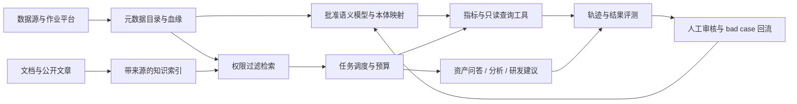

# 推荐落地架构与分阶段实施

这是面向已有数仓、治理和研发体系团队的建议架构；不是已经部署的系统。原则是将口径、权限和结果验证放在模型之外，让 Agent 调用受控能力。

## 各层职责

- **接入**：从现有数据目录、schema、血缘、已批准 SQL 和作业配置读取；记录来源时间及版本。文章与数据源证据分别管理。
- **上下文**：资产索引负责发现，语义模型负责可计算定义，本体负责跨域身份和业务关系。先按用户权限裁剪，再检索和解释；返回来源、版本和过期标识。
- **工具**：search_assets、get_metric、run_readonly_query、resolve_entity、get_lineage；写操作放独立服务和审批策略。生产查询可优先使用批准指标 API，任意 SQL 只开放给授权人员。
- **Harness**：验证结构化动作、调用预算、重试和终止条件；业务终态由执行系统确认。模型输出是建议，工具结果是证据，二者在答复中分清。
- **应用**：目录内嵌检索、指标卡和聊天问数、分析 notebook/报告、IDE/研发工作台 patch。业务人员看结果与来源，研发人员可展开 SQL、质量差异和轨迹。
- **反馈**：按任务 ID 关联提问、授权身份、模型/口径版本、工具调用、验证结果和人工纠错。索引与模型变更前后可对比。

## 三阶段交付与门槛

**第一阶段：一个业务域的可信发现。** 接通只读元数据，整理 20 条常用口径/术语和人工相关性金标；上线资产卡及引用。验收相关性、权限与资料新鲜度；不需要先部署图数据库。

**第二阶段：批准指标分析。** 用语义层对接 5–10 个高频指标，保留 SQL、单位、时间范围和可解释条件；问句存在歧义先澄清。使用保留集比较正确结果、费用和延迟；门槛参考评测专题，业务负责人签认后再开放。

**第三阶段：研发辅助和对象关系。** 先生成分支 patch 和影响分析，隔离运行质量检查，人工审批再发布；仅为明确跨域任务增加本体实体与映射。无人值守写入不在本轮交付范围。

阶段数量和指标数是建议起点，按真实工作量调整；顺序强调先可验证收益再增加自主性。

## 失败与回退

来源过期或证据冲突 → 提示需复核；口径未知 → 澄清；权限不够 → 拒绝且不泄漏对象；预算耗尽 → 返回已有证据和未完成项；SQL/作业失败 → 保留诊断而非编造结果。索引可回滚到上一版，语义与本体映射按版本回放；执行型任务需由作业平台提供幂等和补偿。

## 本库与目标系统的差距

已实现：单进程 SQLite、合成数据、结构化工具、局部预算、来源与回放。未实现：模型接入、真实目录/云平台、生产 IAM、动态检索、作业发布、人工审批服务、跨进程隔离与时态本体。最小案例只验证部分机制，不视作上述架构的部署验收。
