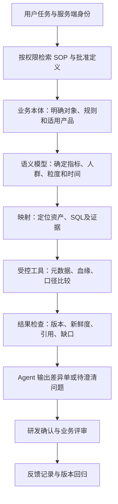

# 架构：让业务定义、数据资产与工作方法一起服务 Agent

## 七层职责

| 层 | 核心对象/职责 | 首期落地 | 与下层的连接 |
|---|---|---|---|
| 数据资产 | 表、字段、作业、报表、负责人、权限、质量、血缘 | 现有目录＋授权导出；不再建一份独立真值目录 | 用平台资产 ID 和来源版本定位 |
| 业务本体 | 实体、属性、关系、事件、状态和约束 | 版本化定义＋业务评审 | 业务概念 ID 不依赖某张物理表名 |
| 计算语义 | 粒度、维度、指标、时间、过滤、关联 | 批准口径＋既有 SQL 引用 | 绑定逻辑字段与可执行实现 |
| 映射 | 业务对象/事实到资产、表达式、证据 | 映射登记＋完整身份＋有效期 | 将概念、语义、资产和规则版本关联 |
| SOP 与工具 | 前置条件、步骤、异常、工具和结果证据 | 人机共用任务契约＋少量只读工具 | 每一步声明需要的对象与证据 |
| Agent 执行 | 选上下文、澄清、调用工具、整理解释 | 公司批准模型入口＋单 Agent 调度 | 工具层验证身份、权限和参数 |
| 评估反馈 | 结果、引用、人工修改、耗时、成本 | 任务日志＋人工评审＋回归集 | 反馈回到定义、映射、SOP 或工具责任方 |

## 一条完整的数据流

以“产品 P 的核销率为什么和报表 B 不一致”为例：先绑定产品及报告版本，澄清按领取批次还是核销发生日统计；随后定位两个指标定义和批准 SQL，沿映射读取粒度、关联和规则。比较出分母、人群、时间、去重或规则差异后，给出证据支持的解释。没有结果数据时，只能确认定义差异，不能声称已经解释数值差额。

## 上下文如何组织

| 类别 | 放入什么 | 不放入什么/处理方式 |
|---|---|---|
| 任务开始时 | 用户问题、已授权业务域、允许工具、适用 SOP、版本要求 | 不灌入全库 DDL 和所有业务文档 |
| 按需检索 | 相关概念、批准指标、映射摘要、已审核 SQL 片段及来源 | 文档中的指令不能修改权限或批准业务规则 |
| 工具实时获取 | 最新 schema、任务状态、质量、血缘、权限及授权聚合结果 | 过期快照不能冒充实时状态 |
| 程序判断 | 参数、权限、预算、版本匹配、引用存在、结构约束 | 不依赖模型自报“我有权限” |
| 人工判断 | 业务定义、规则冲突、因果解释、发布与回写 | confidence 分值不替代业务审批 |

首期按产品、任务类型、批准状态和版本结构化筛选，再用关键词匹配。定义、映射和 SOP 的 ID 必须保留在上下文及结果中。将长文本按需展开，压缩时保留来源、有效期、未决问题和工具结果。

## 建议工具契约

以下是本项目建议接口，**不是 Dataphin 或其他平台已经提供的 API**。实际适配先走现有服务；缺 API 可由授权人员导出相同信息。所有请求的主体由服务端认证得到，不让模型传入身份冒充授权。

| 接口建议 | 输入 | 最小输出 | 失败与限制 |
|---|---|---|---|
| search_assets | 关键词、产品、资产类型 | 可见资产 ID、说明、负责人、更新时间 | 无匹配与无权访问按平台策略返回，不泄漏隐藏资产 |
| get_asset | 资产 ID、可选版本 | 粒度、字段、来源、质量、权限说明 | missing / denied / stale |
| get_lineage | 资产 ID、方向、深度、游标 | 依赖边、采集时间、已覆盖范围、下一游标 | truncated / unsupported；不能把局部图当全图 |
| get_definition | 概念或指标 ID、产品、as_of | 定义、适用规则、版本、批准状态、证据 | ambiguous / unapproved / missing |
| get_mapping | 定义 ID、模型版本 | 资产和逻辑字段、证据条件、完整身份、有效期 | gap / conflict / stale |
| get_approved_sql | SQL ID、版本 | 已审核文本、参数约束、关联指标 | 无批准版本则只返回候选状态 |
| compare_definitions | 两个版本化定义或 SQL 引用 | 时间、粒度、人群、去重、关联差异及定位 | 未识别 UDF/宏标记 unknown，不能判等价 |
| explain_approved_query（可选） | 批准 SQL ID、受限参数 | 引擎诊断、计划引用和时间 | 需要引擎权限；解析/计划不证明结果正确 |
| query_approved_metric（后续） | 指标 ID、时间、允许维度 | 授权聚合结果、快照、单位、查询实例 | 数据权限、分区、费用、时间和返回量控制 |

工具返回统一附带 request_id、source_ref、source_version、observed_at、status、warnings、coverage；数据值与来源一起返回。deny、timeout、partial 不统一包装成“无数据”。具体 wire schema 留给接入阶段按公司接口制定。

## 版本与变更

一次任务冻结本体、语义、映射和 SOP 的版本组合及业务 as_of。工具读到更新 schema 时报告偏差，由规则决定是否停止；不把旧映射套到新字段。关系含义、身份键、指标分母和规则适用范围变化，必须形成影响评审。

例如“有效期从领取后计算改为固定日期”不仅改文档，还可能影响可核销资格、指标人群、历史重算、模型映射与案例预期。规则生效时间与数据到达时间分别记录。过期批准不能自动沿用到新产品。

## 内网实施与组件引入条件

首期将公司资料、模型上下文、日志和检索服务都留在批准的内网环境；对外仓库仅保存公开研究与通用模板，不写企业资产名、真实 SQL、人员或用户标识。日志同样是业务数据，需要最小化和访问控制。

- 图数据库：当实际任务需要反复遍历跨业务对象和多跳依赖、关系表检索已无法满足交互要求时再评估；本体本身不依赖图存储。
- 向量库：关键词和结构过滤的召回经人工标注验证不足时再加；权限过滤必须参与召回及返回过程。
- 多 Agent：只有独立任务分工和单 Agent 的瓶颈已经被测量、能够控制共享状态及成本时再评估。
- 工作流引擎：跨系统长任务需要持久状态、重试、幂等及审批时再接；SOP 文档不会自动变成可靠执行引擎。
